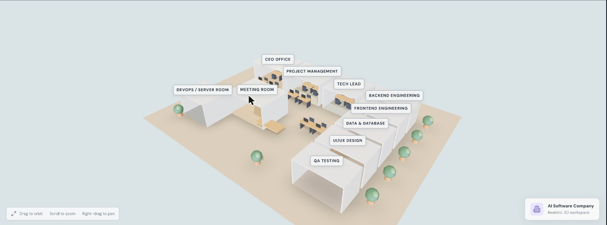
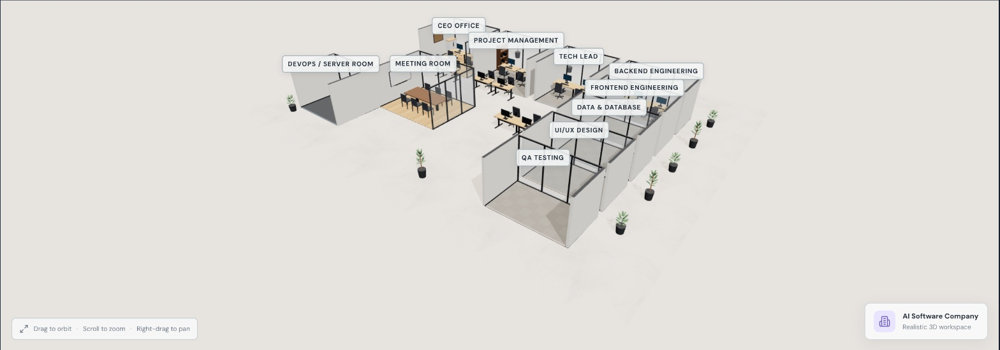
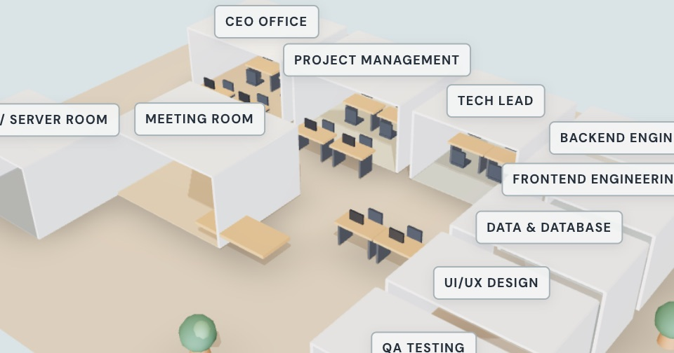
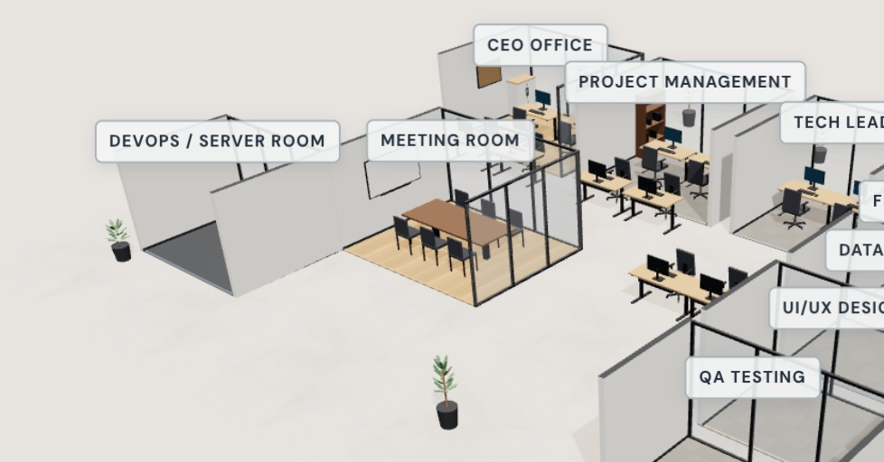
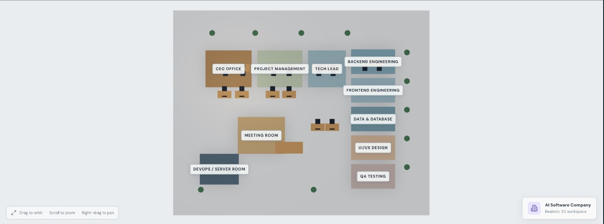
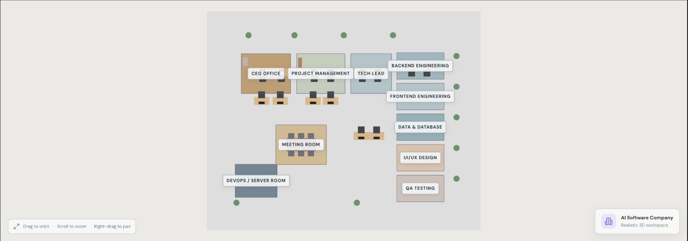
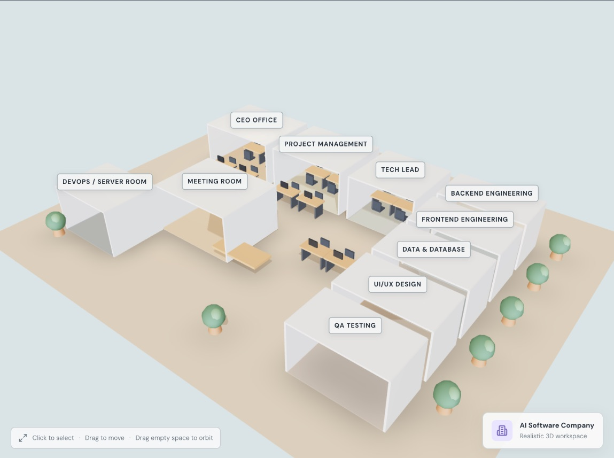
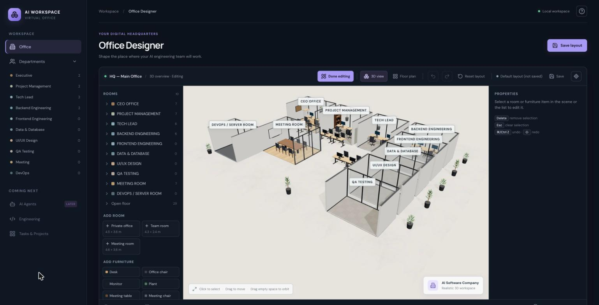

# Milestone 2 — Realistic Office Builder: Final Report

**Spec:** [`milestone-2-plan.md`](milestones/milestone-2-plan.md) · **Task list:** [`milestone-2-tasks.md`](milestones/milestone-2-tasks.md) · **Stages:** A (#8), B (#9), C (#10), D (this PR)

## Summary

The 3D office went from flat coloured boxes to a restrained, realistic modern office: daylight built in code, department floor finishes, cutaway rooms with thick walls and framed glass, detailed procedural furniture, leafy plants and a few wall details. The layout editor, saving, undo/redo, Reset layout and `/vo` all still work. Stage D made rendering cheaper (39% fewer draw calls, and no rendering while idle), bundled the UI fonts so the app makes no remote requests, and verified everything end to end.

| | Before milestone 2 | After |
|---|---|---|
| 3D overview |  |  |
| Close-up |  |  |
| Floor plan |  |  |
| Edit mode |  |  |

## Performance (Stage D)

Measured with the `?stats` overlay on the default layout, using a separate origin (`127.0.0.1:5173`) so no saved layout was involved.
Machine: Apple M2, Chrome 155, canvas at device pixel ratio 2 (capped at 1.7 by the app), viewport 1710 × 985.

- **Draw calls and triangles** are totals for a whole frame: shadow map pass, contact shadows and main pass.
- **CPU** is the main-thread time spent inside `renderer.render` per frame (mean over one second).
- **FPS** is capped at 60 by the display in every case on this machine, so CPU time and frames rendered while idle are the numbers to compare.
- **CPU time is noisy on this laptop** (the same build measured 3.1 ms in one run and 7.5 ms in another), so CPU comparisons come from back-to-back A/B runs, not from separate sessions.

| Scenario | Before (Stage C) | After Task 2 (merged rooms) | After Task 3 (render on demand) |
|---|---|---|---|
| 3D overview, idle | 60 fps · 3.1 ms · 1305 calls · 112,734 tris | 60 fps · 803 calls · 112,734 tris; back-to-back A/B: 7.5 ms → 5.3 ms | idle: no frames rendered |
| 3D overview, orbiting | 60 fps · 3.0 ms · 1305 calls | 60 fps · 749–803 calls | 60 fps while the camera moves (including damping), then 0 · 2.1–2.3 ms · 751–803 calls |
| 3D edit mode, dragging a desk | 60 fps · 2.9 ms · 1305–1346 calls | 803–805 calls in edit mode with a selection (drag not re-measured) | one frame per pointer move · 3.4 ms · 844 calls (the automated drag sends ~5 moves a second, so its fps shows the input rate, not a limit) |
| Floor plan, idle | 60 fps · 2.4 ms · 171 calls · 1,466 tris | 60 fps · 171 calls (unchanged: floor plan draws no walls) | idle: no frames rendered |
| Frames rendered per second while nothing changes | 60 | 60 | **0** |

With render on demand, each of these repaints immediately without moving the mouse (checked in the browser): orbit, zoom, switching between 3D and floor plan, Reset view, hover highlight, select, dragging furniture and rooms, resize handles, undo/redo shortcuts, confirming Reset layout, and resizing the browser window. Room labels follow the camera.

## Files changed and why

**Stage A: lighting, materials, floors, walls (#8)**
- `src/scene/OfficeScene.tsx`: in-code daylight (`Lightformer` panels plus sun and fill) replacing the remote HDR; shadow camera sized to the office; tone mapping; overview camera fitted to the canvas.
- `src/scene/materials.ts`, `textures.ts`, `finishes.ts`: shared material library and procedural floor textures; floor finish by department.
- `src/scene/architecture.ts`, `RoomMesh.tsx`: walls with real thickness, baseboards, cutaway (no ceilings).
- `src/scene/camera.ts`: overview framing. `RoomLabels.tsx`, `labels.ts`: one DOM label layer (fixes a label that could render empty).
- `src/scene/noRemoteAssets.test.ts`: guards against runtime downloads.

**Stage B: furniture models (#9)**
- `src/scene/furnitureModels.ts` (replaces `models.tsx`): desk, monitor, ergonomic chair, meeting table, plus new meeting chair, storage cabinet and shelf, each merged into one geometry per material and shared by every item.
- `src/layout/types.ts`, `catalog.ts`, `validation.ts`: the new furniture types, backward compatible (schema stays v1); footprints match the models.

**Stage C: glass, plants, details (#10)**
- `src/scene/architecture.ts`, `finishes.ts`, `RoomMesh.tsx`: glass partitions with slim graphite frames, wall art and a meeting-room whiteboard (none of them catch clicks).
- `src/scene/furnitureModels.ts`: leafy plants in two sizes, chosen per item id.
- `src/layout/defaultLayout.ts`: meeting chairs and storage in the default office; the meeting table now sits fully inside the meeting room.

**Stage D: optimize and verify (this PR)**
- `src/scene/renderStats.ts`, `StatsOverlay.tsx`: opt-in `?stats` read-out (FPS, CPU time per frame, draw calls, triangles).
- `src/scene/roomGeometry.ts`, `RoomMesh.tsx`: room shells merged into one mesh per material.
- `src/scene/OfficeScene.tsx`: render on demand (`frameloop="demand"`).
- `src/main.tsx`, `src/styles.css`, `package.json`: self-hosted DM Sans and Manrope fonts. `vite.config.ts`: Vitest reads CSS, so the remote-assets test also covers stylesheets and `index.html`.
- `README.md`, this report, `tasks.md`, final screenshots.

## Visual improvements

- **Lighting:** soft late-morning daylight from one side, warm interior fill, gentle shadows over the whole office, contact shadows under furniture.
- **Floors:** light polished concrete in open areas, warm-grey carpet tiles in team rooms, light oak in the meeting room and executive office, dark epoxy in the server room. Department colours are now a subtle floor accent strip.
- **Architecture:** 12 cm walls in warm white with a dark cutaway top, graphite baseboards, framed glass partitions; open fronts so every room is visible.
- **Furniture:** oak desktops on graphite frames with keyboard and mouse, charcoal ergonomic chairs on five-star bases, slim black monitors with a soft screen glow, a walnut meeting table with six meeting chairs, storage cabinets, shelves with books.
- **Details:** leafy plants in two sizes in dark planters, framed art in the CEO office, a whiteboard in the meeting room.
- **Floor plan:** unchanged in spirit and still clear: readable room colours, boundaries, labels and furniture tiles.

## Dependencies and assets

| Added | Why | Licence |
|---|---|---|
| `@fontsource-variable/dm-sans` 5.3.0 | Bundles the DM Sans UI font (Stage D) | SIL OFL 1.1 |
| `@fontsource-variable/manrope` 5.3.0 | Bundles the Manrope heading font (Stage D) | SIL OFL 1.1 |

No rendering dependencies were added. All 3D geometry, materials and textures are procedural. The remote HDR (`lebombo_1k.hdr` from `raw.githack.com`) and the Google Fonts request were both removed, so the app now makes no remote requests at runtime (checked in the browser on both the dev server and `vite preview`).

## Build and test results

- `npm test`: **21 files, 182 tests passed** (84 before the milestone).
- `npm run build`: passes. The existing warning that the main chunk is over 500 kB remains (1,275.61 kB, 361.21 kB gzipped; mostly three.js).
- `npm audit` reports moderate advisories in `vitest` / `@vitest/mocker` (a dev-only test runner, already present before this milestone). The fix is a major upgrade to Vitest 5, so it was left out of this milestone.

## Editor regression checklist (Stage D, dev server, `127.0.0.1:5173`)

| Check | Result |
|---|---|
| Select, move, resize and rename rooms | Pass (selected in 3D and in the list, dragged in floor plan, resized with a handle, renamed in the properties panel; the label updated) |
| Select, move, rotate, duplicate, add and delete furniture | Pass (selected through glass in 3D, dragged in 3D and floor plan, rotated 180° → 270°, duplicated with an overlap warning, added a plant from the palette, deleted with the Delete key) |
| Undo and redo | Pass (⌘Z / ⌘⇧Z) |
| Save → reload restores the layout | Pass (rename, added plant and rotation survived a reload, in dev and in `vite preview`) |
| Reset layout, with its confirmation | Pass (in-app dialog, layout restored) |
| 3D and floor plan stay in sync | Pass |
| Grid and snap | Pass (snap on: −0.5, 0.5; snap off: 0.45, −0.13) |
| Keyboard shortcuts | Pass (undo, redo, Delete, Esc) |
| Selection outlines and labels readable over the new materials | Pass |
| No console errors | Pass (dev and production preview) |

`vite preview` (`127.0.0.1:4173`): loaded, orbited, edited, moved, saved and reloaded with no console errors and no remote requests. `/vo` (`scripts/vo.sh`): a cold start brought up the server and opened the browser; a second run reported "already running" and did not start a second server.

The test origins' local storage was cleared afterwards. The saved layout on `localhost:5173` was never touched.

## Acceptance criteria (plan.md §9)

| # | Criterion | Evidence |
|---|---|---|
| 1 | Noticeably more realistic | Before/after screenshots above |
| 2 | Coherent proportions and materials | Furniture footprints match `catalog.ts` (tests in `furnitureModels.test.ts`); shared material library |
| 3 | Whole office looks good in the overview | `final-overview.jpg`; overview camera fitted to the canvas (`camera.test.ts`) |
| 4 | Floor plan clear and usable | `final-floor-plan.jpg`; floor plan editing checked in Stage D |
| 5 | Moving or resizing rooms updates the 3D scene | Checked in the browser after merging room geometry (Stage D) |
| 6 | Furniture editing and selection work with the new models | Checklist above |
| 7 | Save, refresh and reload preserve the layout | Checklist above (dev and preview) |
| 8 | Undo, redo and reset work | Checklist above |
| 9 | No unnecessary remote dependency | Remote HDR and Google Fonts removed; `noRemoteAssets.test.ts` scans sources, CSS and `index.html`; no remote requests in the browser |
| 10 | Production build passes | `npm run build` passes (chunk-size warning only) |
| 11 | `/vo` starts the app | Checked cold and already-running |
| 12 | Pre-existing issues reported | Known limitations below |

## Known limitations

- Rooms have no doors and no ceilings, by your decision (Q1, Q1b): the cutaway keeps every room visible and editable.
- Furniture is not instanced: each item draws one mesh per material (62 items in the default office). Very large layouts will cost more draw calls; instancing would need its own approach to per-item selection and dragging.
- No real-time ambient occlusion or post-processing (decision 2); contact shadows and tuned shadow maps stand in for it.
- The floor plan still runs the shadow and contact-shadow passes, though they barely show there. They're cheap (171 draw calls) and skipped when idle.
- Pre-existing: a desk, its chair and its monitor are separate items; resize handles are floor-plan only; layouts are per browser and origin; the main chunk is over 500 kB; Vitest has moderate `npm audit` advisories.
- Performance was measured on one machine (Apple M2, Chrome). FPS is display-capped there, and CPU time per frame varies a lot between runs, so only back-to-back comparisons are meaningful.

## How to inspect locally

1. `npm install`, then `npm run dev`, or type `/vo` in Claude Code.
2. Open http://localhost:5173. Orbit the 3D overview, then zoom into the meeting room and the CEO office.
3. Click **Floor plan** for the top-down view, and **Edit layout** to drag, rotate, add and resize.
4. Add `?stats` to the URL to see draw calls and CPU time. It reads "idle" while nothing moves.
5. For the production build: `npm run build && npm run preview`, then open http://127.0.0.1:4173.
